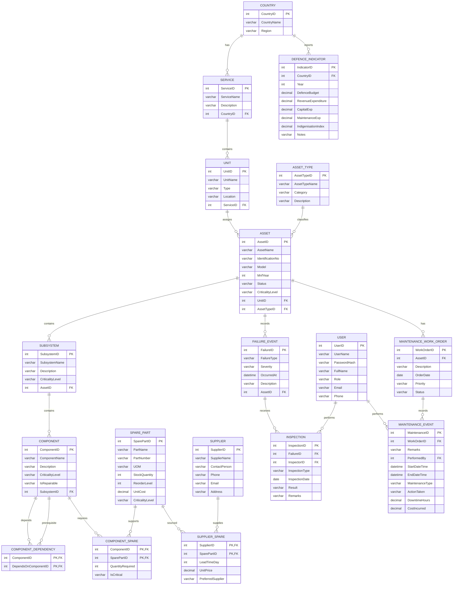

# Defence Asset Readiness & Maintenance Dependency System ERD

This Mermaid ER diagram is derived from the verified MySQL schema export
[`Dump20261101.sql`](../Dump20261101.sql). It documents the existing tables,
keys, and foreign-key relationships; it does not create or alter database
objects.

`USER` is shown as an entity name for readability; SQL statements must quote
the table as `` `USER` `` where required by MySQL.
